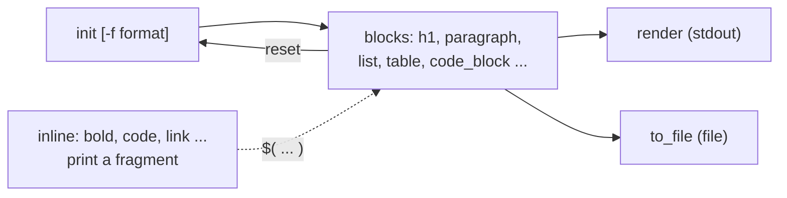

# Markdown builder

`shell::markdown::*` builds Markdown documents from Bash: a title, paragraphs, lists, tables, code blocks. The same calls produce standard Markdown, **Telegram MarkdownV2** (for `sendMessage` with `parse_mode=MarkdownV2`) or plain text. Code lives in `src/markdown/`; the defaults are in `src/constant/markdown.sh`.

It is the library's only Markdown/MarkdownV2 converter. The git notifications (backup, rename, merge, commit, tag, revert) are built with it and sent as MarkdownV2; see [Used by the git module](#used-by-the-git-module).

| Property    | Value                                                                         |
| ----------- | ----------------------------------------------------------------------------- |
| Audience    | Script authors who build reports, README files or chat messages in shell      |
| Last review | 2026-11-11 (library commit `ffccb24`)                                         |
| Shells      | bash 3.2+ and zsh; output is identical in both                                |
| Source      | `src/markdown/`, `src/constant/markdown.sh`; tests in `test/test_markdown.sh` |

## Loading

Source the library once, for example from `~/.bashrc` or `~/.zshrc`. This loads the `markdown` group with the others. No external tool and no `eval` are needed.

```bash
source "$HOME/shell/src/shell.sh"
```

## Quick start

Build a document in four steps: `init`, add blocks, `render`. Each inline helper (`bold`, `code`, `link` ...) goes inside `$( ... )` and returns a fragment for the text of a block.

```bash
shell::markdown::init                                   # 1. new document (format: markdown)
shell::markdown::h1 "Release notes"                     # 2. add blocks
shell::markdown::paragraph "Version $(shell::markdown::bold v1.4.0) is out."
shell::markdown::list "Faster startup" "Fixed $(shell::markdown::code 'git rebase') hang"
shell::markdown::render                                 # 3. print the document
```

Output:

```markdown
# Release notes

Version **v1.4.0** is out.

- Faster startup
- Fixed `git rebase` hang
```

Write it to a file instead of printing it with `shell::markdown::to_file release-notes.md` (step 4). Change only the first line to `shell::markdown::init -f telegram` and the same calls produce Telegram MarkdownV2; see [Recipes](#recipes).

## Lifecycle



```text
init  ->  append blocks  ->  render  ->  to_file
```

```bash
shell::markdown::init -f telegram     # new empty document, format telegram
shell::markdown::h1 "Deploy"          # block functions append to the buffer
shell::markdown::paragraph "Done in 3.2s"
shell::markdown::render               # print it
shell::markdown::to_file report.md    # or write it
```

Three kinds of function, never mixed:

| Kind   | Examples                                         | Effect                                   |
| ------ | ------------------------------------------------ | ---------------------------------------- |
| inline | `bold`, `italic`, `code`, `link`, `image` ...    | print a **fragment**; document untouched |
| block  | `h1`, `paragraph`, `list`, `table`, `code_block` | append to the buffer; print nothing      |
| output | `render`, `to_file`                              | read the buffer; never change it         |

Block functions change variables of the current shell: do not call them inside `$( ... )` or a pipeline. Inline functions are meant for `$( ... )`.

- Blocks are separated by one empty line; `render` ends with exactly one newline; an empty document renders nothing.
- Rendering twice gives the same text.
- **Format changes:** a block is formatted when it is appended, with the format selected at that moment. `set_format` changes what comes next; it does not convert the buffer. Select the format first (`init -f`).
- One document per shell. Use `reset` to start over, or `render` into a variable to keep a finished one.

## Composing: fragments

Inline functions escape their text and return a _fragment_. A block function escapes the plain parts of its argument and keeps fragments as they are:

```bash
title=$(shell::markdown::bold "Git History")
shell::markdown::paragraph "$title for v1.2.3"      # telegram: *Git History* for v1\.2\.3
```

Fragments carry two invisible marker characters so no block escapes them twice. The markers never reach the buffer. If you print a fragment yourself, strip them with `shell::markdown::unwrap`. `shell::markdown::fragment` marks text you wrote in the format's own syntax so it is kept verbatim (never use it for untrusted input).

## Public API

All functions accept `-h` / `--help` as their **only** argument. Errors go to stderr and return `RETURN_INVALID` (2); nothing but the result goes to stdout.

### Document

| Function                             | What it does                                                                 |
| ------------------------------------ | ---------------------------------------------------------------------------- |
| `init [-f <format>]`                 | New empty document; format `markdown` (default), `telegram` or `plain`       |
| `reset`                              | Empty the document, keep the format                                          |
| `set_format <format>` / `get_format` | Select / print the format                                                    |
| `append <text>`                      | Add text at the very end, unescaped, no separator                            |
| `raw <markdown>`                     | Add trusted Markdown as its own block, unescaped                             |
| `render`                             | Print the document                                                           |
| `to_file [-n] <file>`                | Write the document (rc 3 when the directory is missing, `-n` writes nothing) |

### Inline (print a fragment)

| Function            | markdown                                          | telegram                | plain       |
| ------------------- | ------------------------------------------------- | ----------------------- | ----------- |
| `bold`              | `**t**`                                           | `*t*`                   | `t`         |
| `italic`            | `*t*`                                             | `_t_`                   | `t`         |
| `bold_italic`       | `***t***`                                         | `*_t_*`                 | `t`         |
| `underline`         | `<u>t</u>`                                        | `__t__`                 | `t`         |
| `strikethrough`     | `~~t~~`                                           | `~t~`                   | `t`         |
| `spoiler`           | `<span class="spoiler">t</span>`                  | `\|\|t\|\|`             | `t`         |
| `code`              | `` `t` `` (longer delimiter if `t` has backticks) | `` `t` ``               | `t`         |
| `link <text> <url>` | `[t](url)`                                        | `[t](url)`              | `t (url)`   |
| `image <alt> <url>` | ``                                     | `[alt](url)` (fallback) | `alt (url)` |

Empty text gives an empty fragment (never a stray `**`). `link` with empty text uses the URL as text; a URL with a newline is refused.

### Blocks

| Function                               | markdown                                   | telegram                                             | plain                  |
| -------------------------------------- | ------------------------------------------ | ---------------------------------------------------- | ---------------------- |
| `heading <1-6> <text>`, `h1` `h2` `h3` | `#` .. `######`                            | **bold line** (no headings exist; the level is lost) | text; h1/h2 underlined |
| `paragraph`                            | text                                       | text                                                 | text                   |
| `blockquote`                           | `> ` per line                              | `>` per line                                         | `> ` per line          |
| `horizontal_rule`                      | `---`                                      | a line of `─` (`SHELL_MARKDOWN_TELEGRAM_RULE`)       | a line of `-`          |
| `code_block [<lang>] <code>`           | fence, longer than any backtick run inside | triple backticks, `` ` `` and `\` escaped            | indented 4 spaces      |

The language is limited to letters, digits and `_ + . # -`. The code is never Markdown-escaped and cannot close its own fence.

### Lists

`list_item`, `ordered_item`, `nested_item <level> <text>`, `list <items...>`, `ordered_list <items...>`.

- Consecutive items form one list; any other block ends it. Ordered numbering restarts after another block.
- Markdown: `- ` and `1. `, nested items indented 4 spaces per level.
- Telegram has no lists: `•` `◦` `▪` bullets and `1\.` numbers, 2 spaces per level.
- Multi-line items are aligned under their first line.

### Tables

```bash
shell::markdown::table_header "Hash" "Author" "Message"
shell::markdown::table_align left center right     # optional
shell::markdown::table_row "a1b2c3" "John" "Add feature"
shell::markdown::table                              # append the table, clear it
```

- Markdown: a pipe table, columns padded, `|` written `\|`, newline in a cell written `<br>`, alignment via `:---`.
- Telegram has no tables: each row becomes `*Header:* value` lines, rows separated by an empty line. **Empty cells are left out**, newlines become spaces, alignment does not apply. Use plain text for header cells (a bold header would nest bold in bold).
- Short rows are padded; extra cells add columns with an empty header (`Column N` on Telegram).

### Escaping

| Function      | Escapes                       |
| ------------- | ----------------------------- |
| `escape_text` | everything in normal text     |
| `escape`      | the same, but keeps fragments |
| `escape_url`  | URLs                          |
| `escape_code` | code                          |

Each takes `-f <format>` to override the document's format.

| Context     | Telegram MarkdownV2                                    | Markdown                                                                     |
| ----------- | ------------------------------------------------------ | ---------------------------------------------------------------------------- |
| normal text | `_ * [ ] ( ) ~ ` > # + - = \| { } . ! \` each with `\` | ``\ ` * _ [ ] < ~`` always; `# > + - =` and `1.` only at the start of a line |
| code        | `` ` `` and `\` only                                   | nothing (the fence is lengthened)                                            |
| link URL    | `)` and `\` only                                       | space, `"`, `<`, `>`, `(`, `)` percent-encoded                               |
| table cell  | as normal text                                         | `\|` added                                                                   |

Unicode (including Vietnamese) is passed through untouched; backslashes are escaped; code blocks and URLs are never escaped as normal text.

## Telegram MarkdownV2

Output follows the [MarkdownV2 style](https://core.telegram.org/bots/api#markdownv2-style): the escaping above, `*bold*`, `_italic_`, `__underline__`, `~strike~`, `||spoiler||`, `` `code` ``, fenced code, `[text](url)` and `>` quotes. Structures Telegram lacks use the fallbacks listed in the tables (headings, rules, lists, tables, images).

What is verified: the escaping and syntax are covered by `test/test_markdown.sh` against the documented rules, in bash and zsh. What is **not** verified: nothing here has been sent to the real Bot API, and the limits below are known.

- An entity cannot be nested inside the same kind, and italic directly around underline (or the reverse) is ambiguous (`___`). Avoid both.
- A bold fragment inside a heading or a table header nests bold in bold.
- Telegram limits a message to 4096 characters; the builder does not split.
- `shell::telegram::send` defaults to the legacy `parse_mode=markdown`, which has different escaping. Send builder output with `shell::telegram::send -m markdownv2 <token> <chat_id> <text>` (`shell::git::telegram::history::send -m markdownv2 <text>` does the same with the stored keys).

## Used by the git module

`_shell::git::telegram::notify <title> [<label> <value>]...` (`src/lang/git.sh`) builds every git notification in one layout and sends it with `parse_mode=MarkdownV2`:

```text
*Branch renamed*

*Old:* `feat/a`
*New:* `feat/b`

*Repository:* [widget](https://github.com/acme/widget)
*User:* Jane Doe
*Time:* 2026\-11\-07 22:30:00
```

- The title is bold; each field is `*Label:* value`; identifiers (labels in `SHELL_GIT_NOTIFY_CODE_LABELS`: branch, hash, tag ...) are inline code, everything else is escaped text.
- The repository links to its web page when the remote is web-hostable. Credentials in the remote URL are never sent.
- Values are cut at `SHELL_GIT_NOTIFY_VALUE_MAX` (500) characters; empty values are left out.
- The message is built in a subshell, so a document you are building with `shell::markdown::*` is not touched.

## Examples

The same report, built by the same code for two formats:

```bash
report() {
  shell::markdown::init -f "$1"
  shell::markdown::h1 "Git History"
  shell::markdown::paragraph "Commits of $(shell::markdown::code src/lib/git.sh) since v1.2.0 - see $(shell::markdown::link 'the repo' 'https://github.com/pnguyen215/shell')."
  shell::markdown::table_header "Hash" "Author" "Message"
  shell::markdown::table_align left left left
  shell::markdown::table_row "$(shell::markdown::code a1b2c3)" "John" "Add feature"
  shell::markdown::table_row "$(shell::markdown::code d4e5f6)" "David" "Fix bug"
  shell::markdown::table
  shell::markdown::list_item "Features"
  shell::markdown::nested_item 1 "$(shell::markdown::bold 2) new commands"
  shell::markdown::list_item "Fixes"
  shell::markdown::code_block bash "git log --oneline -n 2"
  shell::markdown::render
}
report markdown
report telegram
```

### Standard Markdown

````markdown
# Git History

Commits of `src/lib/git.sh` since v1.2.0 - see [the repo](https://github.com/pnguyen215/shell).

| Hash     | Author | Message     |
| :------- | :----- | :---------- |
| `a1b2c3` | John   | Add feature |
| `d4e5f6` | David  | Fix bug     |

- Features
  - **2** new commands
- Fixes

```bash
git log --oneline -n 2
```
````

### Telegram MarkdownV2

````text
*Git History*

Commits of `src/lib/git.sh` since v1\.2\.0 \- see [the repo](https://github.com/pnguyen215/shell)\.

*Hash:* `a1b2c3`
*Author:* John
*Message:* Add feature

*Hash:* `d4e5f6`
*Author:* David
*Message:* Fix bug

• Features
  ◦ *2* new commands
• Fixes

```bash
git log --oneline -n 2
```
````

## Recipes

Every output below was produced by running the code in bash and zsh (2026-11-11).

### 1. Send a Telegram message

Select `telegram` first, build the message, then send it with the `markdownv2` parse mode. The default parse mode of `shell::telegram::send` is the legacy `markdown`, which escapes differently.

```bash
shell::markdown::init -f telegram
shell::markdown::h1 "Deploy finished"
shell::markdown::paragraph "Version $(shell::markdown::bold 1.4.0) took 3.2s - $(shell::markdown::link 'logs' 'https://ci.example.com/run/42')"
message=$(shell::markdown::render)
shell::telegram::send -m markdownv2 "$TOKEN" "$CHAT_ID" "$message"
```

`$message` is:

```text
*Deploy finished*

Version *1\.4\.0* took 3\.2s \- [logs](https://ci.example.com/run/42)
```

### 2. Put untrusted text in a document

Pass text from users, commits, filenames or command output as a plain argument. The block escapes it for the selected format; do not escape it yourself first and do not use `raw` for it.

```bash
msg='Fix: a_b *c* [x](y) 1.5!'

shell::markdown::init -f telegram
shell::markdown::paragraph "$msg"
shell::markdown::render      # Fix: a\_b \*c\* \[x\]\(y\) 1\.5\!

shell::markdown::init
shell::markdown::paragraph "$msg"
shell::markdown::render      # Fix: a\_b \*c\* \[x\](y) 1.5!
```

### 3. One table, two formats

```bash
shell::markdown::init
shell::markdown::table_header "Name" "Status" "Ms"
shell::markdown::table_align left center right
shell::markdown::table_row "api" "ok" "12"
shell::markdown::table_row "db" "slow" "840"
shell::markdown::table
shell::markdown::render
```

```markdown
| Name | Status |  Ms |
| :--- | :----: | --: |
| api  |   ok   |  12 |
| db   |  slow  | 840 |
```

With `init -f plain` (plus `h1 "Report"` before the table) the same table prints as:

```text
Report
======

Name: api
Status: ok

Name: db
Status: slow
```

### 4. Build a document inside a function

Call the builder inside the function and capture only the final `render`. The function runs in a subshell when you write `text=$(build ...)`, so the buffer it fills is discarded afterwards and one document never leaks into the next.

```bash
build() {
  shell::markdown::init -f "$1"
  shell::markdown::h2 "Status"
  shell::markdown::blockquote "all green"
  shell::markdown::render
}
text=$(build telegram)
printf '%s\n' "$text"
```

```text
*Status*

>all green
```

### 5. Write to a file, safely

```bash
shell::markdown::init
shell::markdown::h1 "Saved"
shell::markdown::to_file -n ./out.md   # prints "shell::markdown::render > ./out.md", writes nothing
shell::markdown::to_file ./out.md      # writes the file (replaces it)
```

`to_file` returns 3 and writes nothing when the directory does not exist, and 2 when the path is a directory.

### 6. Add Markdown you wrote yourself

`raw` adds one trusted block without escaping; `code_block` adds code without escaping and without letting it close its own fence.

```bash
shell::markdown::code_block bash 'echo "hi"'
shell::markdown::raw '<details><summary>More</summary></details>'
```

````markdown
```bash
echo "hi"
```

<details><summary>More</summary></details>
````

## Troubleshooting

| Symptom                                               | Cause                                                                       | Fix                                                                                   |
| ----------------------------------------------------- | --------------------------------------------------------------------------- | ------------------------------------------------------------------------------------- |
| `render` prints nothing after a block call            | the block ran in a subshell (`$( ... )`, a pipe)                            | call block functions in the current shell; use `$( ... )` only for inline functions   |
| Telegram rejects the message (`can't parse entities`) | sent with the legacy `markdown` parse mode, or text was escaped twice       | use `shell::telegram::send -m markdownv2`; pass plain text and let the builder escape |
| Earlier blocks keep the old format                    | `set_format` does not convert the buffer                                    | select the format with `init -f <format>` before adding blocks                        |
| Text such as `1.5` shows `1\.5` in the output         | `telegram` escapes `.`; `markdown` escapes `1.` at the start of a line only | expected: renderers remove the backslash                                              |
| `Unknown format 'x'`                                  | format is not `markdown`, `telegram` or `plain`                             | use one of the three names                                                            |
| `Start a table with table_header first`               | `table_row`, `table_align` or `table` called before `table_header`          | call `table_header` first; `table` clears the table, so start a new one for the next  |
| Table header looks nested-bold on Telegram            | a `bold` fragment was used as a header cell                                 | pass plain text as header cells                                                       |

## Design notes

- `src/markdown/escape.sh` has the only escaping code (per-character `case`, so no `eval`, `sed` or GNU tool) and the fragment logic; `document.sh` the state; `inline.sh`, `block.sh`, `list.sh`, `table.sh` the builders.
- Helpers are private `_shell::markdown::*` functions and return text through `SHELL_MARKDOWN_OUT`, because command substitution would strip trailing newlines.
- Not supported: several documents at once, rewriting a finished buffer when the format changes, message splitting.
